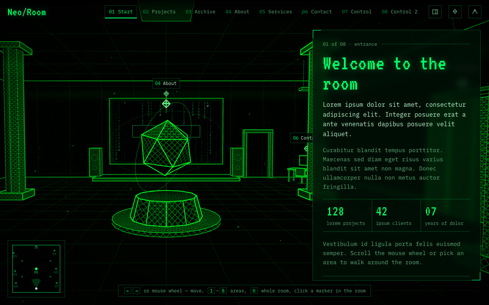
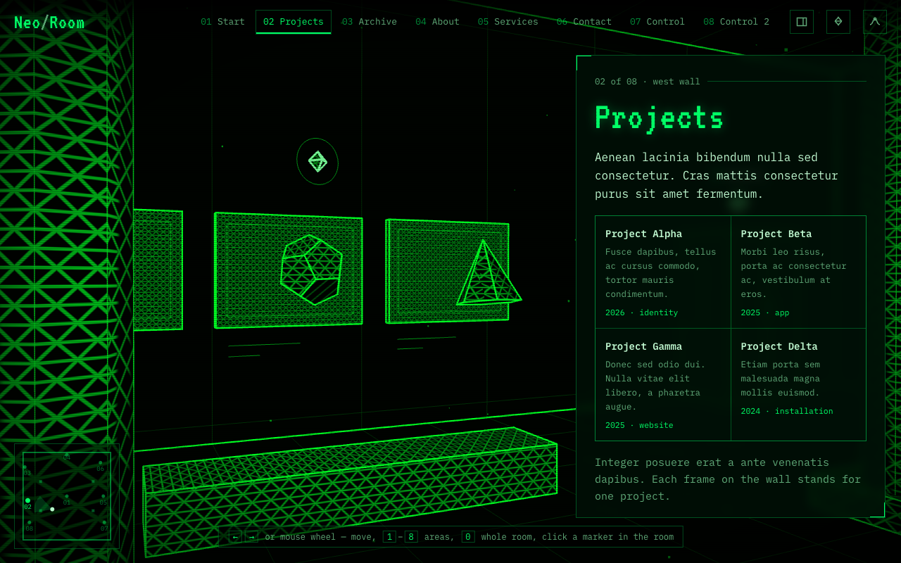
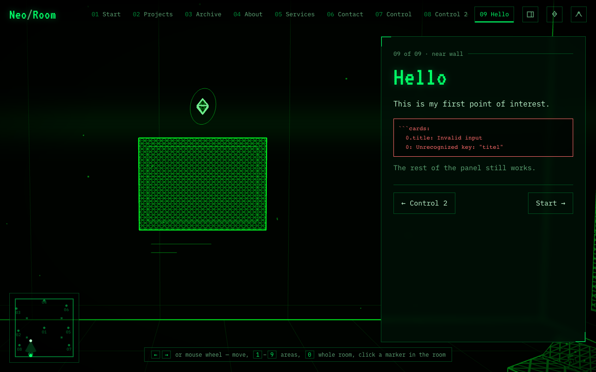

# Writing panel content

This page shows how to write the text panel that slides in at each point of interest: ordinary text in Markdown, plus five special blocks for numbers, cards, lists, timelines and forms. Most panels are one Markdown file in the scene's `content/` folder.

## Ordinary text

Panels use Markdown, the same plain-text format as many wikis and chat apps:

```markdown
# The title of the panel

The first paragraph after the title is the introduction and is shown slightly larger.

A normal paragraph, with **bold**, *italic*, `code` and a [link](https://example.com).

## A smaller heading

- a list item
- another one

| A | small | table |
| --- | --- | --- |
| works | too | here |
```

- Start with one `#` title. It appears with a "decoding" animation when the panel opens.
- Links to other websites open in a new tab.
- A line ending with `\` starts a new line without starting a new paragraph, which is handy for addresses.



*A panel: the title, the larger introduction, ordinary text and a `stats` block.*

## Special blocks

A special block is a fenced block (three backticks) whose first line names the block. Its body is a list of items in JSON, the same format as the point-of-interest files.

**Numbers in a row** (`stats`):

````markdown
```stats
[
  { "value": "128", "label": "projects" },
  { "value": "42", "label": "clients" }
]
```
````

**Cards in a grid** (`cards`). `text` and `meta` are optional:

````markdown
```cards
[
  { "title": "Project Alpha", "text": "A short description.", "meta": "2026 · identity" },
  { "title": "Project Beta", "text": "Another one.", "meta": "2025 · app" }
]
```
````

**A list with icons** (`list`). The icon defaults to `/`:

````markdown
```list
[
  { "icon": "▶", "title": "Fri 19:00", "text": "A short film." },
  { "title": "Design", "text": "What we do." }
]
```
````

**A timeline** (`timeline`):

````markdown
```timeline
[
  { "title": "2019", "text": "Studio founded." },
  { "title": "2026", "text": "This website." }
]
```
````

**A form** (`form`). Field `type` can be `text` (the default), `email` or `textarea`:

````markdown
```form
{
  "fields": [
    { "name": "name", "label": "Name" },
    { "name": "email", "label": "E-mail", "type": "email", "required": true },
    { "name": "message", "label": "Message", "type": "textarea" }
  ],
  "submit": "Send message",
  "action": "https://example.com/contact"
}
```
````

Without `action`, pressing the button only shows "This is a prototype — the message was not sent." With `action`, the answers are sent to that address. Whoever runs that address must accept them; ask your operator.



*A `cards` block in the Projects panel.*


*A `timeline` block in the About panel.*


*A `form` block in the Contact panel.*

> **Warning.** If a block's JSON has a mistake, the panel shows the block in red with the problem: a missing comma, a misspelt field such as `titel`, or a missing `label`. The rest of the panel still works.



*A `cards` block with `titel` instead of `title`. The block turns red and says what is wrong; the rest of the panel still shows.*

## Writing the panel inside the point-of-interest file

For a short panel you can skip the Markdown file and list the pieces in the point-of-interest file instead:

```json
"content": {
  "blocks": [
    { "type": "heading", "text": "Services" },
    { "type": "markdown", "text": "One paragraph of **Markdown**." },
    { "type": "list", "data": [{ "title": "Design", "text": "What we do." }] }
  ]
}
```

Each piece is a `heading`, a `markdown` text, or one of the special blocks with its items in `data`.

## What visitors also see

Below your content the panel always has buttons to the previous and next stop. Above it is a small line with the stop number, the total, and your `kicker`.
