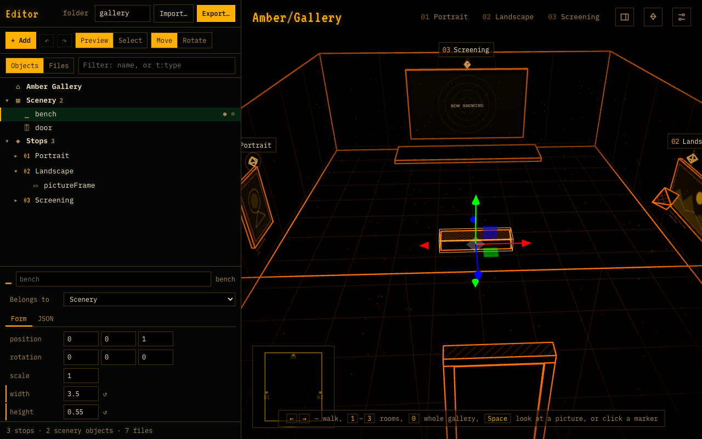
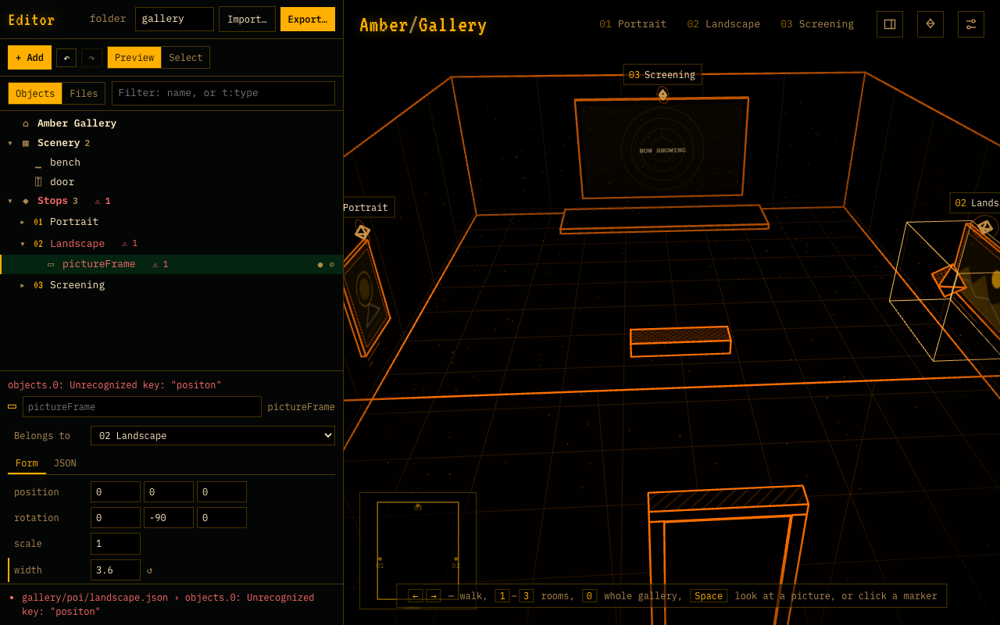

# Editing in the browser

This page shows how to build a scene without touching the repository: edit its files in the browser with the room updating live, then download the folder.

## Open the editor

Open `edit.html` next to the app, for example `http://localhost:5173/edit.html`. Add `?scene=gallery` to start from an existing scene instead of the one-stop template.

*The editor opened with `?scene=gallery`. Left: the files and the text of the selected one; right: the live room.*

The left pane lists the scene's files. Click one to edit it; the room on the right follows a moment after you stop typing. The usual keys work in the room (`1`–`9`, `0`, `H`, `M`, `Esc`); the scroll wheel scrolls the editor when the mouse is over it.

## Make changes

- **Edit a file.** Everything on the [scene.json](../operator/reference/scene-json.md) and [point of interest](../operator/reference/poi-json.md) pages applies. A mistake shows up under the text in red, as `file › field: problem`, and the file turns red in the list. The room keeps showing the last version that worked.

  

  *A misspelt `position` in a point-of-interest file. The file turns red in the list and the problem is named under the text; the room on the right is unchanged.*
- **New point of interest.** Choose an object type in the dropdown, click **New point of interest**, give it a name. A file `poi/<name>.json`, a page `content/<name>.md` and the entry in `scene.json` are created, with the camera and marker placed automatically.
- **Add to …** appends an object of the chosen type to the file you are editing (to `decor` when that is `scene.json`), with every setting written out at its default, so you can see what there is to change.
- Pictures and videos: write their paths as usual (`"media/photo.jpg"`); they show once the files are in the folder's `media/` directory on the server.

## Import

**Import…** at the top takes files from your computer:

- **A scene zip**: one you exported earlier (a scene folder or a whole site), or any zip with a `scene.json` in it. The editor opens that scene, with its pictures, videos, data files and modules kept in memory, so the preview shows them and the next export includes them. The folder name is taken from the zip.
- **Media files** (pictures, videos, audio, `.js` modules, `.json` data): they are added under `media/` in memory. Write `"media/<file name>"` in a file and the preview shows them at once; they go into the next export too.

An imported zip replaces what the editor currently shows, so export first if you want to keep your changes.

## Export a scene or a site

**Export…** unfolds a section with two settings and two kinds of zip. The settings are saved in the room's `scene.json`, so the preview on the right follows them at once and both zips carry them:

| Setting | What it does |
| --- | --- |
| **Allow free flight** | Untick it and visitors cannot take the camera by hand: the fly keys and the middle mouse button do nothing, and the hint at the bottom no longer mentions them. Visitors still move between stops |
| **opens at** | Where the room opens for someone who arrives without a `#stop` in the address: the whole room from above, one of the stops, or a **fixed view**. For a fixed view, move the camera where you want it (fly there, or go to a stop and step up to a screen) and click **Use current view**; the numbers under the dropdown are that position. A link with `#stop` still opens at that stop |

Below the settings the editor lists the files the zip gets besides the text files: those the room refers to (pictures, videos, data files, modules) and those you imported. A file is taken from memory if it was imported, otherwise fetched from the room's published folder. Two kinds of file cannot be found by reading the room: files an object type's own module loads (models, textures) and media that live data answers with. Import them, or copy them into the unzipped folder by hand. A room that was never published and has nothing imported shows its files in red after an export; add them the same way.

Then pick the zip:

| Button | Gives | Use it when |
| --- | --- | --- |
| **Scene folder .zip** | `<folder>.zip`, holding `<folder>/` with the text files and the files above | the room joins a site that hosts several rooms. Send the zip to whoever runs the site, or unzip it into the site's `scenes/` folder yourself and add the folder name to `scenes/index.json`. Visitors open `…/?scene=<folder>`. This folder is also what goes into `public/scenes/` in the repository when a room should ship with the app |
| **Whole site .zip** | `<folder>-site.zip`: the viewer, this room and its files, ready to unzip onto any web host that serves plain files | the room gets an address of its own. Its `index.html` opens the room; the editor is not part of it. From the development server the first export takes a few seconds longer, while the viewer is built |

> **Note.** Doors or frames that link to another room (`?scene=…`) lead nowhere in a one-room site.
