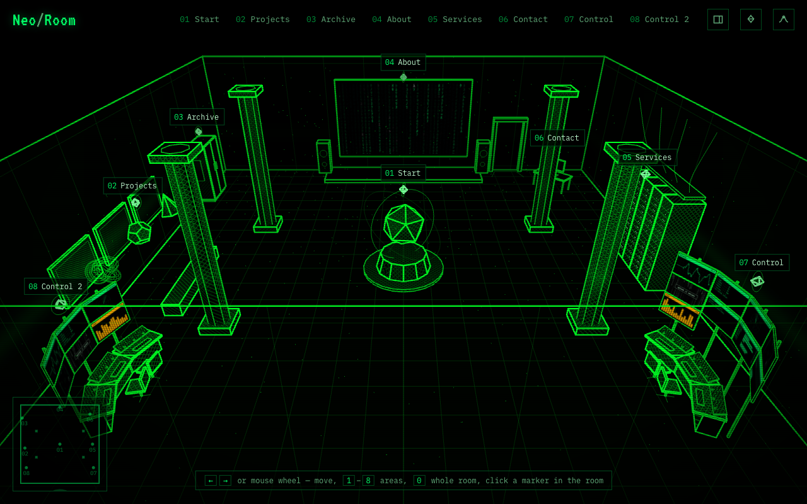
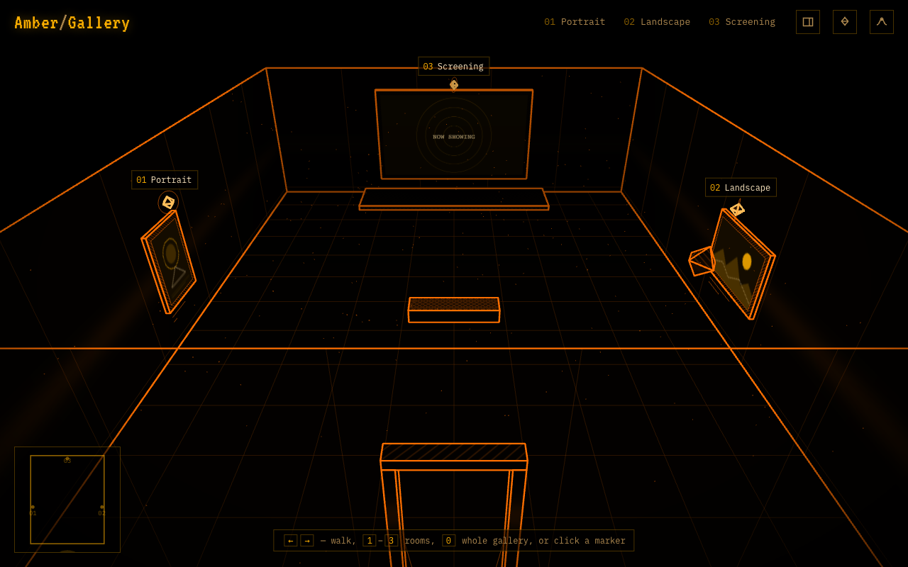
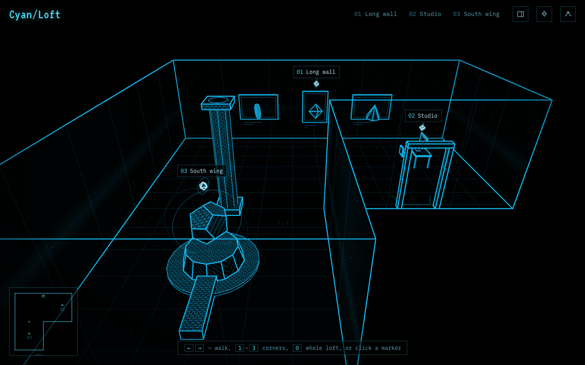

# Examples and ideas

This page describes the four example scenes that ship with Scene Rooms and some ideas for your own, so you can decide quickly whether a room fits what you want to show. Open each example and look at its files side by side.

## The examples

**RoomKit Cinema** (`public/scenes/cinema/`, the default and the home page). A cinema hall with six stops: the big screen playing an intro film, a wall of feature posters, a projection booth with six live screens, a server rack, an editor desk with a console, and four doors that lead to the other rooms and the documentation. Look here to see:

- a scene that opens on a stop instead of the whole room (`"camera": { "start": "welcome" }` in `scene.json`);
- a video on the cinema screen (`poi/01-welcome.json`, `media/intro.mp4`);
- two object types the scene brings along, rows of seats and a projector (`prefabs/seats.js`, `prefabs/projector.js`), placed as `decor`;
- doors with `openUrl` actions (`poi/06-exits.json`);
- live data: every booth screen and the numbers in the Booth panel read `data/showtimes.json` every 20 seconds, each through its own transform (`data/transforms.js`).

**kKEo Room** (`public/scenes/neo-room/`). Open it with `?scene=neo-room`. A green "Matrix" studio website with eight stops: a floating shape at the entrance, project frames on a wall, a wardrobe archive, an "about us" cinema screen, a server room for services, a desk with a contact form, and two control centres, one with a wall of nine screens and a smaller one opposite. Look here to see:

*kKEo Room.*

- one stop with several objects and a hand-placed camera (`poi/02-projects.json`);
- a stop with no camera at all, placed automatically (`poi/03-archive.json`);
- a panel written inside the point-of-interest file instead of Markdown (`poi/05-services.json`);
- a control desk where every screen shows something different: graphs, typed text, a picture, its own rain, and a console, a filterable table and a form you can use up close (`poi/07-control.json`);
- live data: the node table, the FLEET numbers, the NODE LOAD bars and the numbers in the Control panel all read `data/nodes.json` every 15 seconds. Edit that file and watch them change.

**Amber Gallery** (`public/scenes/gallery/`). A smaller amber room with two framed pictures and a cinema screen showing a poster. Open it with `?scene=gallery`. Look here to see:

- your own pictures in frames and on a screen (`media/`);
- a different theme, fog, easing curve and interface words, all in `scene.json`.

*Amber Gallery, seen whole.*

**Cyan Loft** (`public/scenes/loft/`). An L-shaped cyan room with three stops: a long wall of frames, a studio desk behind a partition, and a pedestal in the south wing. Open it with `?scene=loft`. Look here to see:

- a room that is not a box, drawn from a `footprint` (`scene.json`);
- picture frames and a door that react to clicks with `actions` (see [Making objects clickable](objects.md#making-objects-clickable)).

*Cyan Loft, seen whole.*

## Ideas

| Idea | Objects to use |
| --- | --- |
| Portfolio: one frame per project, an "about" screen, a contact desk | `pictureFrame` with `image`, `cinemaScreen`, `desk` |
| Virtual exhibition: artworks with captions and a floating sculpture | `pictureFrame` with `exhibit`, `pedestal` |
| Product tour: one stop per feature, a video on the big screen | `cinemaScreen` with `source: "video"`, `primitive` |
| Team page: a wardrobe "archive" of past projects, a timeline of the company | `wardrobe`, `timeline` blocks |
| Event page: programme on the screen, sign-up form at the desk | `list` and `form` blocks |
| Live status board: service health, sales figures or a stream from the stage | `controlDesk` with `stats`, `dashboard` and graph screens fed from a `feed`; `cinemaScreen` with an `.m3u8` video |

> **Note.** A room is meant for a handful of stops (up to nine). For long text, such as documentation, link out to a normal web page from a panel.
