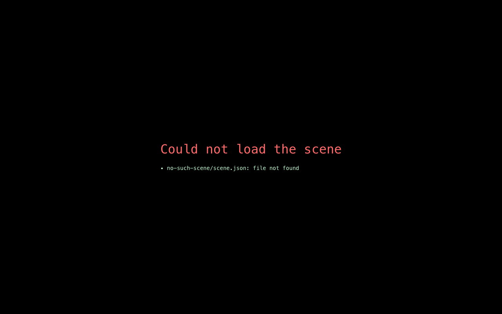

# FAQ and troubleshooting

This page lists the problems people run into most often and how to fix them. Most start with a red **Could not load the scene** message, which names the file and the line at fault.

## The loading screen shows "Could not load the scene"

*The loading screen when a scene cannot be loaded. Here the address asked for a scene folder that does not exist.*

The message lists every problem it found, one per line, as `file › place: problem`. For example, `neo-room/poi/09-hello.json › objects.0.type` means "in `09-hello.json`, the `type` of the first object" (counting starts at 0).

| The message says… | What it means | Fix |
| --- | --- | --- |
| `file not found` | The file is not where a list says it is. | Check the spelling and folder in the `poi` list of `scene.json`, or the `markdown` path in the point-of-interest file. Paths are relative to the scene folder. |
| `invalid JSON — …` | The file is not valid JSON. | Usually a missing or extra comma, or a missing quote. The message gives the position. Paste the file into any online JSON checker. |
| `unknown object type "…" (known: …)` | The `type` is misspelt. | Copy one of the names in brackets; capitals matter (`pictureFrame`). |
| `id may contain only letters, digits, "-" and "_"` | The `id` has a space or other character. | Use something like `my-stop`. |
| `duplicate id "…"` | Two points of interest use the same `id`. | Give one of them a new `id`. |
| `at most 9 POIs (number keys 1–9)` | The `poi` list is too long. | Remove one, or split the content over two scenes. |
| `a point of interest needs at least one object` | `objects` is empty. | Add at least one object. |
| `Invalid input: expected number, received string` | A number is in quotes, such as `"width": "16"`. | Remove the quotes. |
| `invalid scene name "…"` | The `?scene=` in the address has odd characters. | Use the folder name exactly. |

## The page loads, but…

**A block in the panel is red.** The JSON inside that block has a mistake, or the block name is wrong. The red text says which. See [Writing panel content](content.md).

**My picture doesn't show; the frame has green rain instead.** The picture could not be loaded. Check that the file is in the scene's `media/` folder and the path is `media/name.jpg`. Capitals matter on most servers.

**A screen's title bar shows a `!`, or a panel block says "not updating".** Its live data could not be loaded: the address is wrong, the site is down, or it does not allow your site to read it. The last data stays on show. Check the address in the `feed`; for another website, ask its owner or your operator. See [Live screens](objects.md#live-screens).

**The camera is inside a wall, or something blocks the view.** The automatic camera does not know about other objects. Add a `camera` with your own `position` and `target`. See [Placing a point of interest](points-of-interest.md).

**My object is half inside the floor or the wall.** Floor objects need height `0`. Wall objects need the wall's exact position, for example `15` for a 30-metre-wide room, and the right rotation.

**I changed a file but nothing changed.** Reload the page. If you are looking at a hosted site, the server may cache files for a few minutes. Ask your operator.

**The floating diamonds are gone.** Someone pressed `M`, or the scene sets `"markers": false`. Press `M` to bring them back.

**The room is very slow on my laptop.** Open **Options → General** and lower the render resolution (75 % or 50 % helps most), turn off smooth edges and reload, or set the dust particles to half or off. **Options → System** shows the frame rate as you change them. For every visitor at once, lower `particles` in the scene's `effects`. Very old computers without 3D graphics support cannot show the room.

## Still stuck?

Open the browser's developer console (usually `F12`). Problems with pictures and videos are reported there as "Could not load image …". Send the red message, or the console line, to whoever runs your site.
