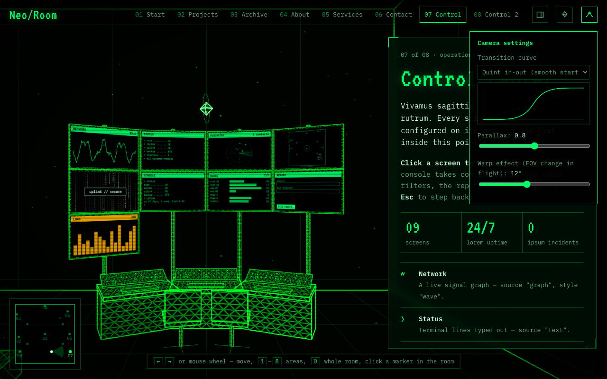
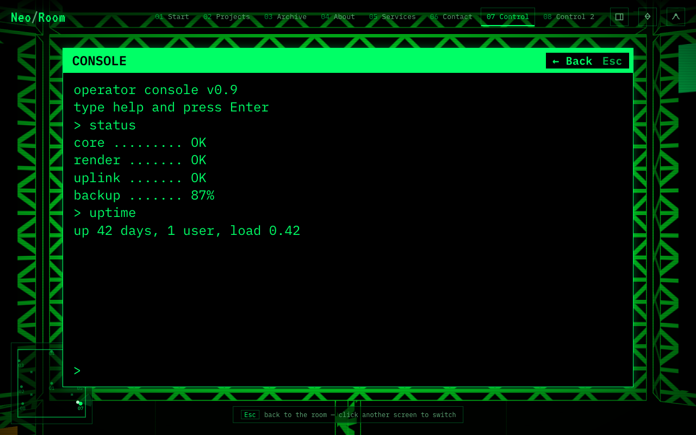

# Using the room: moving around

This page is what your visitors can do, and the addresses you can share to send them straight to a spot. Read it before you write instructions for your own visitors.

## Moving between points of interest

The room opens with a view of all of it from above. From there, `→` goes to stop 1 and `←` to the last stop.

*What visitors see at a stop. Top: the bar with every stop; right: the panel; bottom-left: the map; above the object: its diamond.*

| To… | Do this |
| --- | --- |
| Go to the next or previous stop | Press `→` / `←` (or `↓` / `↑`), scroll the mouse wheel, or swipe left or right on a phone |
| Jump to a stop | Press its number key `1`–`9`, click it in the top bar, or click its label or floating diamond in the room |
| See the whole room | Press `0` or click the logo in the top-left corner. The camera rises above the room and looks into it from the front, like a model with the roof off |
| Hide or show the text panel | Press `H` or click the panel button in the top bar |
| Hide or show the floating diamonds | Press `M` or click the diamond button in the top bar |
| Change the picture quality, the camera's feel, or see technical details | Click the **Options** button (the sliders) at the right end of the top bar. See [Options](#options) below |

## Options

The **Options** button at the right end of the top bar opens a panel with three tabs. `Esc` closes it.

**General** sets how the room is drawn on this computer. These choices are saved in the browser, so they stay after a reload and apply to every room.

| Option | What it does |
| --- | --- |
| Render resolution | **Auto** draws at the screen's sharpness, up to 2×. A lower percentage draws fewer pixels and is much lighter on a slow graphics chip, at the cost of a softer picture |
| Frame rate limit | Caps the frames per second at 120, 60 or 30. A lower limit saves battery and keeps a laptop cooler; **Unlimited** follows the display |
| Dust particles | All, half or none of the floating specks |
| GPU preference | On computers with two graphics chips, asks for the fast one or the battery-saving one |
| Smooth edges (antialiasing) | Smooths jagged edges; turning it off is faster on weak hardware |
| Show performance overlay | A small box in the top-left corner with the frame rate, frame time, CPU and GPU time and a graph of recent frames |
| Restore defaults | Puts every General option back |

GPU preference and smooth edges only change when the page is loaded again: the panel says so and offers a **Reload now** button.

**Camera** holds the transition curve (with a graph of its shape), the parallax amount and the warp amount.

*The Camera tab of Options.*

**System** shows what the room costs to draw and what it runs on, updated four times a second:

- **Rendering:** frames per second, average and worst frame time, CPU time per frame, how busy the page's main thread is with drawing, GPU time per frame, long pauses in the last 10 seconds, and what is drawn (draw calls, triangles, objects, shaders), with a graph of recent frame times (dashed lines at 60 and 30 fps; taller bars are slower frames).
- **Memory:** the page's JavaScript memory, roughly how much memory the device has, and how many shapes and textures are on the graphics chip.
- **Graphics, Display, Device:** the graphics chip and its limits, the screen and canvas sizes, the number of processor threads, the browser and the network.

Some browsers keep some of these figures to themselves (GPU time, long pauses and memory are mostly reported by Chrome and Edge only); the panel then says *not reported by this browser*. **Copy report** puts everything on the clipboard as text, ready to paste into a bug report.

## Using a screen up close

Screens, monitors and pictures that belong to a stop can be clicked. The pointer turns into a hand and the screen brightens when you hover over one.

| To… | Do this |
| --- | --- |
| Step up to a screen | Click it, or press `Space` once you have arrived at a stop to step up to the screen in front of you. If it belongs to another stop, the first click takes you to that stop and the second one steps up to the screen |
| Switch to the screen next to it | Press `→` or `←` (`↓` / `↑` or `PageDown` / `PageUp` also work, and are the keys to use on a video, where `←` `→` seek), or click the neighbouring screen at the edge of the view. The order runs left to right along the wall and wraps around |
| Use it | Type commands, filter a table or fill in a form, depending on the screen (see [Objects you can place](objects.md#screens-you-can-use)) |
| Step back | Press `Esc`, click **← Back** in the screen's corner, or click anywhere outside the screen |

*Up close to a terminal screen. The hint at the bottom changes to "Esc back to the room", and the Back button sits in the screen's corner.*

While you are up close, the text panel and the diamonds are switched off, and the arrow keys only move between the screens of the same stop (not while you are typing in one), so typing never moves the camera. Clicking a stop in the top bar still takes you there.

## Flying freely

Visitors with a keyboard and mouse can also leave the stops and fly the camera themselves, like in a 3D editor. Pressing a fly key or dragging with the middle mouse button starts it; the text panel closes and the bottom hint lists the keys.

| To… | Do this |
| --- | --- |
| Fly forward, back, left or right | Hold `W`, `S`, `A` or `D`. Forward goes where you look, so looking down and pressing `W` dives |
| Fly straight down or up | Hold `Q` or `E` |
| Fly slower, for fine positioning | Hold `Shift` as well (a third of the speed) |
| Look around | Hold the middle mouse button (press the wheel) and drag |
| Slide forward or back | Scroll the mouse wheel |
| Stop flying | Go to any stop the usual way: an arrow key, a number key, `0`, a click on a diamond, a label or the top bar. The camera flies there from wherever you are |

The keys sit where `W`, `A`, `S`, `D`, `Q` and `E` are on an English keyboard, whatever the layout (on a French keyboard that is `Z`, `Q`, `S`, `D`, `A`, `E`). Free flying is off while you are up close to a screen, and there is no free flying on phones.

## The view and the map

Moving the mouse tilts the view a little, so the room feels deep (not while flying freely). On phones the view drifts slowly on its own instead.

The small map in the bottom-left corner shows the room from above: the dots are the stops, the bright one is where you are, and the cone shows where the camera is looking.

## Sharing a link to a spot

Every stop has an address. Add `#` and the stop's `id` to the site address:

| Address | Opens |
| --- | --- |
| `https://your-site/` | the default room, seen whole from above |
| `https://your-site/#contact` | the default room, at the stop whose `id` is `contact` |
| `https://your-site/?scene=gallery` | the room called `gallery` |
| `https://your-site/?scene=gallery#screening` | the `gallery` room, at its `screening` stop |

The address bar updates as visitors move, so they can copy it to share where they are.

> **Note.** People who ask their computer to reduce motion get short, plain transitions with no parallax. That is on purpose.
