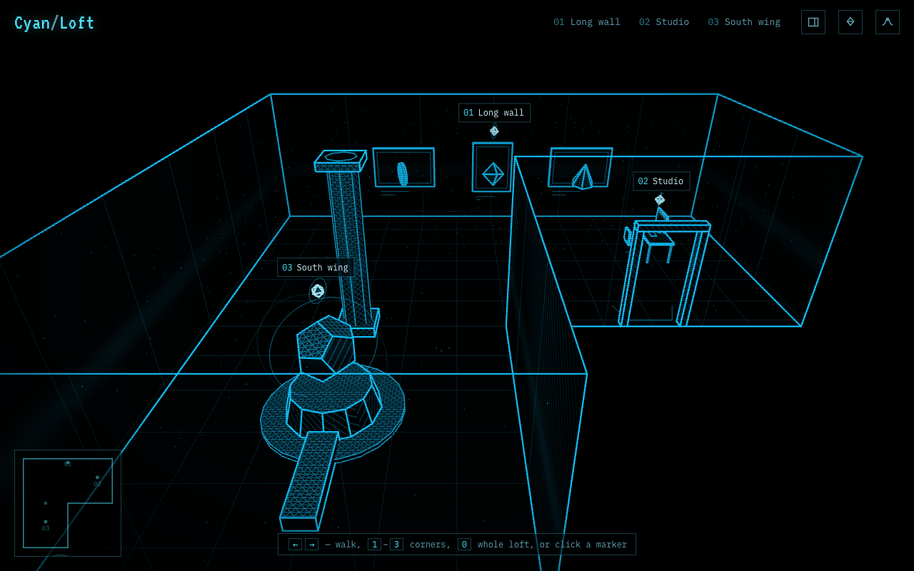
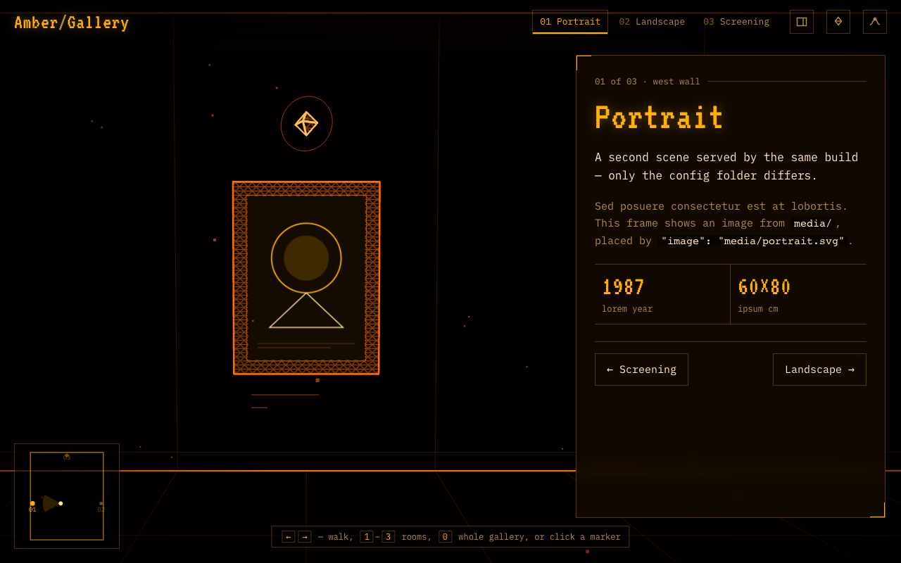

# Making a new scene

This page shows how to start a whole new room, with its own size, colours and points of interest, next to the existing ones. A scene is one folder; outside it only `public/scenes/index.json` changes, which lists every scene (and names the default).

The quick way is `node tools/scene.js new my-office`: it makes the folder with a room and one point of interest and adds it to `index.json`. Then run `node tools/scene.js check my-office` after each edit; it lists every mistake, from a misspelt key to an object standing outside the room. The steps below do the same by hand.

## 1. Create the folder

Make a folder in `public/scenes/` named after your scene, using lowercase letters, digits and `-`, for example `public/scenes/my-office/`, with these inside:

```
my-office/
  scene.json
  poi/        one file per point of interest
  content/    panel texts
  media/      pictures and videos (optional)
```

## 2. Write scene.json

The smallest useful `scene.json` names the room and lists the points of interest:

```json
{
  "title": "My Office",
  "brand": "My/Office",
  "room": { "width": 16, "height": 6, "depth": 20, "lights": [[0, 5.6, 0]] },
  "poi": ["poi/desk.json", "poi/wall.json"]
}
```

- `title` is the browser tab name. In `brand`, the `/` is shown dimmed.
- `room` sets the size in metres. The room is centred on `0`: with a width of 16, the side walls are at `-8` and `8`.
- `lights` are positions. A light near the ceiling becomes a flat ceiling panel; a lower one hangs on wires.

A room need not be a box. Give `footprint` instead of `width` and `depth`: the corners of the floor, in order, as `[x, z]` pairs. This L-shaped room is 24 m across with its top-right quarter missing:

```json
"room": { "height": 7, "footprint": [[-12, -12], [12, -12], [12, 0], [0, 0], [0, 12], [-12, 12]], "lights": [[-6, 6.6, 0]] }
```

Walls, grids, the minimap and the whole-room view all follow the outline. The `loft` example scene is built this way.



*The `loft` example: an L-shaped `footprint`, with the minimap following the same outline.*

Everything you leave out keeps its default: the green colours, the fonts, the camera speed.

## 3. Change the look

Add a `theme` to change colours. Any colour you leave out stays green:

```json
"theme": {
  "accent": "#ffb000",
  "highlight": "#ffe0a0",
  "text": "#ffe9c2",
  "textDim": "#b08a50",
  "surface": "rgba(20,12,0,.78)",
  "scanlines": false
}
```

`accent` colours the lines in the room and the titles. `surface` is the panel background. `scanlines` turns the old-monitor stripes on or off. The `gallery` example scene uses exactly this amber theme.



*The `gallery` example with the amber theme above. Everything that was green, from the walls to the panel title, follows `accent`.*

You can also replace the interface words, for example the loading text and the hint at the bottom:

```json
"ui": { "loading": "Opening the office", "hint": "[←][→] — walk, [1]–[{total}] rooms, [0] whole office" }
```

In the hint, `[x]` is drawn as a key and `{total}` becomes the number of points of interest. The [Interface strings](../operator/reference/ui-strings.md) page lists every word you can replace.

## 4. Add decoration

Objects that are not points of interest, such as doors and benches, go in `decor`. They use the same format as objects in a point-of-interest file:

```json
"decor": [ { "type": "door", "position": [0, 0, 10], "rotation": [0, 180, 0] } ]
```

## 5. Open it

Open the site with `?scene=my-office` at the end of the address. To make it the scene everyone sees first, change `"default"` in `public/scenes/index.json`:

```json
{ "default": "my-office", "scenes": ["neo-room", "gallery", "my-office"] }
```

## Keeping the description

If the room was built from a description ("a desk in the corner, three pictures on the far wall"), keep it next to the scene in a `brief.json`, with a list of what must therefore be true:

```json
{
  "text": "A desk in the north-east corner, three pictures on the far wall.",
  "expect": [
    { "object": "desk", "corner": "north-east" },
    { "count": "pictureFrame", "is": 3, "wall": "north" }
  ]
}
```

`node tools/scene.js check my-office` then tells you whether the room still matches, also after later changes. `node tools/scene.js new my-office --brief="…"` starts the file for you. The forms are listed in the [brief.json reference](../operator/reference/brief-json.md).

Every other setting, such as the camera fly-in, where the room opens (`camera.start`: a stop or a fixed view), whether visitors may fly freely (`camera.freeFly`), fog and particles, is listed in the [scene.json reference](../operator/reference/scene-json.md).
