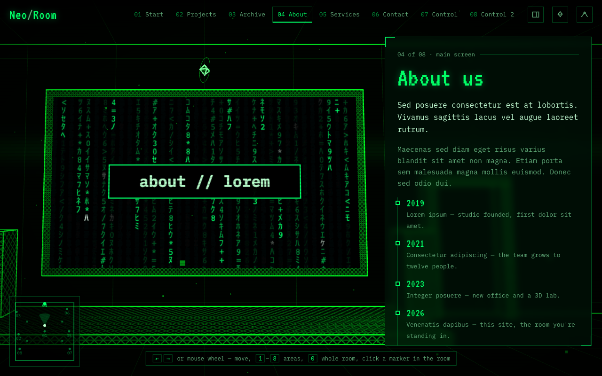
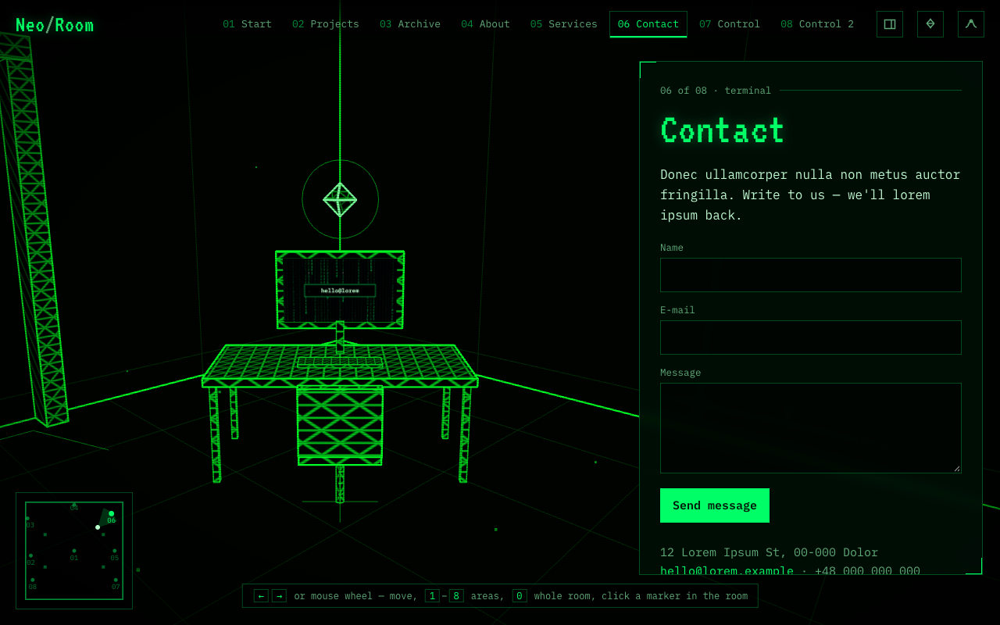
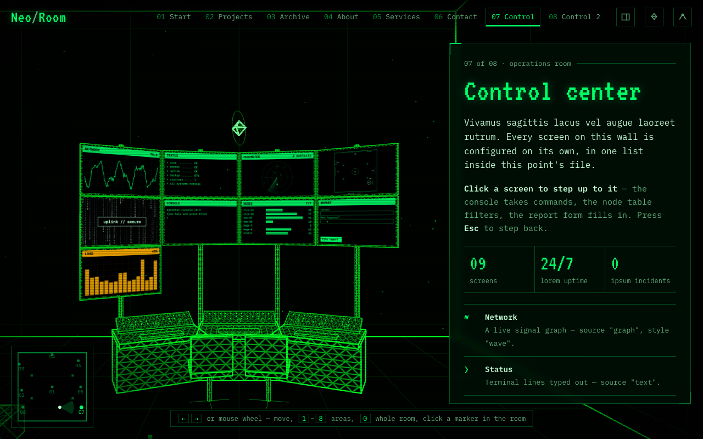
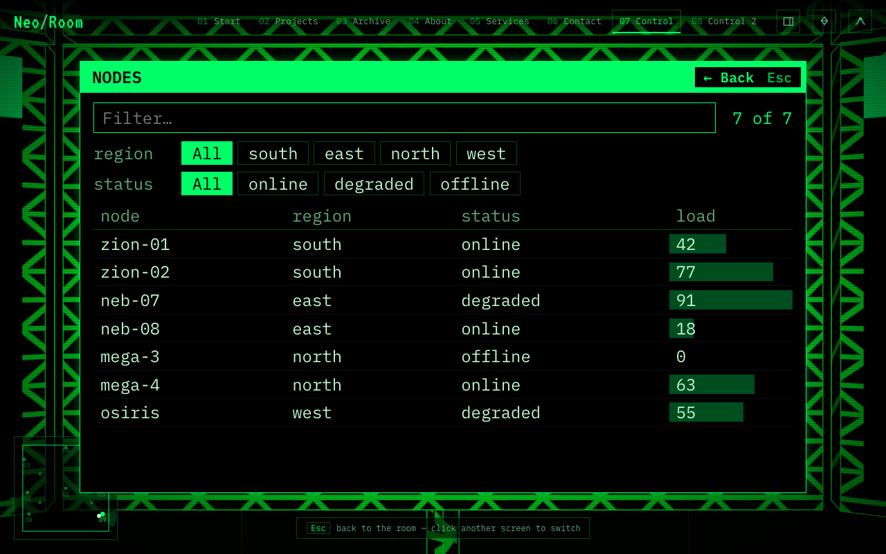

# Choosing objects

This page describes each kind of object you can put in a room, with the settings you are most likely to change. You choose the kind with `"type"` and change its settings in `"props"`. The [Prefab reference](../operator/reference/prefabs.md) in the Operator guide lists every setting with its default.

```json
{ "type": "wardrobe", "position": [-14.4, 0, -10], "rotation": [0, 90, 0], "props": { "height": 3.5 } }
```

Leave out `"props"` to use the defaults. Sizes are in metres.

A room can also bring object types of its own: a developer puts a small module in the scene folder and lists it under `"prefabs"` in `scene.json`, and you place it like any type here. The `loft` example has a `lamp` made this way. See [Scene-shipped prefabs](../operator/extending/scene-prefabs.md) in the Operator guide.

## Things that stand on the floor

Put these at height `0`.

| Type | What it is | Settings worth knowing |
| --- | --- | --- |
| `desk` | A desk with a monitor, keyboard and chair. Visitors look at it from the chair side. | `screen`: `"rain"` (default), `"image"` or `"video"` with `src` for the file, or a full screen like the ones on a control desk (`{ "source": "text", "title": "…", "lines": [...] }`). `chair`: `false` to remove it. |
| `wardrobe` | A two-door wardrobe with clothes and boxes inside. Its doors swing open while its panel is shown. | `width`, `height`, `depth`. `openOnFocus`: `false` keeps it shut. |
| `pedestal` | A low stand with a slowly turning shape floating above it, wrapped in rings. | `shape`: `icosahedron`, `dodecahedron`, `octahedron`, `box`, `sphere`, `cone`, `torusKnot` and more. `height` of the floating shape. |
| `controlDesk` | A curved control-centre console with operator chairs and a wall of screens behind it. Every screen can show something different (see below). | `screens`: one entry per screen. `columns`: screens per row (3). `segments`, `radius`, `arc`: the shape of the desk. `chairs`: how many. |
| `serverRack` | A row of server cabinets with blinking lights and cables to the ceiling. | `count` of cabinets. `cables`: `false` to remove the cables. |
| `bench` | A plain block to sit on, or use as a plinth. | `width`, `height`, `depth`. |

## Things that hang on a wall

Put these at the wall's position (for example `15` across for the right wall) and turn them to face into the room.

| Type | What it is | Settings worth knowing |
| --- | --- | --- |
| `pictureFrame` | A frame. Give its **centre** height as the position's middle number. | `image`: a picture file such as `"media/photo.jpg"`. `width`, `height`. `exhibit`: a shape that floats in front of the frame, such as `"cone"`. |
| `cinemaScreen` | A big screen with a stage and two speakers. Put it at height `0`; the screen is raised for you. | `source`: `"rain"`, `"image"` or `"video"`, with `src`. `width`, `height`, `elevation` (height of the screen's centre). `stage`, `speakers`: `false` to remove them. |
| `door` | A door frame. Decoration only. Put it at height `0`. | `width`, `height`. |



*A `cinemaScreen` showing the shared rain and this stop's `screenLabel`.*



*A `desk`. Its monitor shows the rain by default; the panel holds a form block.*

## Anything else

| Type | What it is | Settings worth knowing |
| --- | --- | --- |
| `primitive` | A single shape: `box`, `sphere`, `cylinder`, `cone`, `torus`, `torusKnot`, `icosahedron`, `dodecahedron`, `octahedron`, `tetrahedron` or `plane`. | `shape`, `size`. `spin`: turning speed. `float`: how far it bobs up and down. |

## Control desk screens

A `controlDesk` takes a list of screens. They fill the wall left to right, top row first, and each one is set up on its own:



*The control desk of the example room. Nine screens in four columns: the last one wraps onto a third row, and has its own amber `color`.*

```json
{
  "type": "controlDesk",
  "position": [12, 0, 9],
  "rotation": [0, -90, 0],
  "props": {
    "columns": 3,
    "screens": [
      { "source": "graph", "graph": "wave", "title": "NETWORK" },
      { "source": "text", "title": "STATUS", "lines": ["> core ..... OK", "> uplink ... OK"] },
      { "source": "graph", "graph": "radar", "title": "PERIMETER" },
      { "source": "image", "src": "media/floorplan.svg" },
      { "source": "rain", "label": "uplink // secure" },
      { "source": "graph", "graph": "bars", "title": "LOAD", "color": "#ffb000" }
    ]
  }
}
```

| A screen with… | Shows |
| --- | --- |
| `"source": "graph"` | a live chart under a `title`: `"graph": "wave"` (a moving signal), `"bars"` (bouncing levels) or `"radar"` (a sweeping radar) |
| `"source": "text"` | a `title` bar and your `lines`, typed out like a terminal, again and again |
| `"source": "image"` or `"video"` | the file in `src`, as for frames |
| `"source": "rain"` with a `label` | its own green rain with your words in the middle |
| nothing (`{}`) | the room's shared rain, with this stop's screen label |

Add `"color": "#ffb000"` to any graph, text or rain screen to give that one screen its own colour. Six screens in three columns make two rows; eight screens in four columns make two rows of four.

## Screens you can use

Visitors can click any screen of a stop (control desk screens, the desk monitor, the cinema screen, pictures in frames) to step up to it, and press `Esc` to step back. Three kinds of screen do more once you are up close:

| A screen with… | Up close, visitors can… | Settings |
| --- | --- | --- |
| `"source": "terminal"` | type commands and read the answers | `title`, `lines` (shown before anything is typed), `prompt` (`"> "`), `commands`: each name answers with one line or a list of lines. `help`, `clear`, `goto 3` (or `goto contact`) and `exit` always work |
| `"source": "dashboard"` | filter a table by clicking chips or typing | `title`, `rows` (a list of records), `columns` (which fields, in order; all by default), `filters` (fields that get a row of chips), `value` (a number field drawn as a bar) |
| `"source": "form"` | fill in and send a form | `title`, `form`: the same `fields`, `submit` and `action` as the [form block](content.md) |

```json
{ "source": "terminal", "title": "CONSOLE",
  "lines": ["type help and press Enter"],
  "commands": { "status": ["core ... OK", "uplink ... OK"], "whoami": "visitor" } },
{ "source": "dashboard", "title": "NODES", "filters": ["region"], "value": "load",
  "rows": [
    { "node": "zion-01", "region": "south", "load": 42 },
    { "node": "neb-07", "region": "east", "load": 91 }
  ] },
{ "source": "form", "title": "REPORT",
  "form": { "fields": [{ "name": "subject", "label": "Subject" }], "submit": "File report" } }
```



*A `dashboard` screen up close. The `filters` become rows of chips and the `value` field is drawn as a bar.*

From across the room the screen shows a preview: the last lines typed, the filtered bars, or the empty form. What visitors typed or filtered stays on the screen after they step back, until the page is reloaded.

To stop a screen from being clicked, add `"zoom": false` to that screen, or to the `props` of a `desk`, `cinemaScreen` or `pictureFrame`. Screens of objects listed under `decor` in `scene.json` are not clickable unless you give them an action (next section).

## Making objects clickable

Any object can react to a click. Add `actions` next to its `props`, naming the part of the object and what the click does:

```json
{ "type": "pictureFrame", "position": [5, 3, -12],
  "actions": { "frame": { "type": "goTo", "poi": "studio" } } }
```

The part lights up when the mouse is over it. What you can click, per object: `pictureFrame` → `frame` and `image`; `desk` → `screen` and `chair`; `door` → `door`; `bench` → `bench`; `pedestal` → `solid`; `wardrobe` → `doors`; `serverRack` → `rack`; `cinemaScreen` → `screen`; `controlDesk` → each screen by its `id` (or `scr0`, `scr1`, …); `primitive` → `shape`.

What a click can do:

| Action | Example | Effect |
| --- | --- | --- |
| go to a stop | `{ "type": "goTo", "poi": "studio" }` | flies there and opens its panel; `"poi": null` shows the whole room |
| open a link | `{ "type": "openUrl", "url": "https://example.com" }` | in a new tab (add `"newTab": false` to leave the page) |
| hide or show the panel | `{ "type": "togglePanel" }` | the same as the `H` key |
| step up to a screen | `{ "type": "zoom", "screen": "scr2" }` | zooms into that screen of the current stop |

A misspelt part name is reported on the loading screen together with the names the object has. The `loft` example scene uses actions on its picture frames and its door.

## Pictures and videos

Put image and video files in the scene's `media/` folder and refer to them as `"media/name.jpg"`. Pictures are cropped to fill the frame without stretching. Videos play silently, on a loop. While a file is loading, or if it cannot be found, the screen shows the green rain instead.

> **Tip.** JPEG, PNG, SVG and WebP pictures all work. For videos, MP4 (H.264) plays in every browser.
