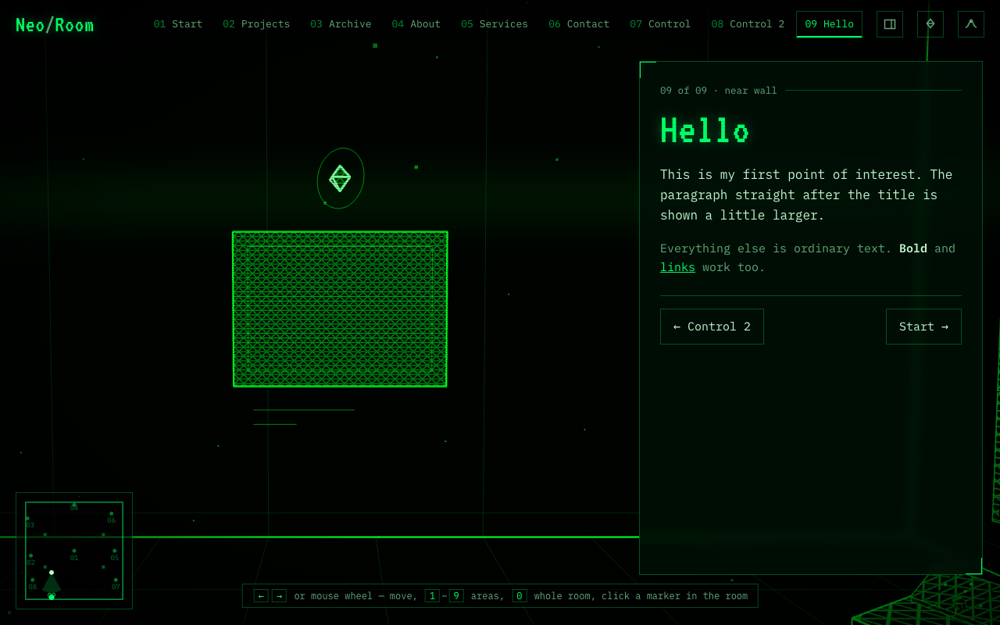

# Quick start: your first point of interest

This walk-through adds a picture frame with your own text to the example room. It takes about ten minutes. You will create two small files, add one line to a third, and reload the page.

## Before you start

You need a running copy of the site that shows your changes. If someone else runs it for you, ask them for the preview address and where the `public/scenes/` folder is. If the project is on your computer, open a terminal in the project folder and run:

```bash
make dev      # then open the address it prints, usually http://localhost:5173
```

If `make` is not available, run `npm install` once and then `npm run dev`.

You should see the green room fly in and settle on a view of the whole room. Press `1` to walk to **01 Start**:


*The first stop of the example room. The panel on the right is what you will write in a moment.*

## 1. Describe the point of interest

Create the file `public/scenes/neo-room/poi/09-hello.json` with this content:

```json
{
  "id": "hello",
  "label": "Hello",
  "kicker": "near wall",
  "objects": [
    { "type": "pictureFrame", "position": [-7, 3.2, 15], "rotation": [0, 180, 0] }
  ],
  "content": { "markdown": "content/hello.md" }
}
```

This says: put a picture frame on the near wall, the one behind you when you first enter (`15` is that wall's depth, `-7` puts the frame left of centre, `3.2` is the height of its centre). Turn it round (`180`) to face into the room, and show the text from `content/hello.md` when a visitor arrives. The camera position is worked out for you.

## 2. Write the text

Create `public/scenes/neo-room/content/hello.md`:

```markdown
# Hello

This is my first point of interest. The paragraph straight after the title is shown a little larger.

Everything else is ordinary text. **Bold** and [links](https://example.com) work too.
```

## 3. Add it to the room

Open `public/scenes/neo-room/scene.json`, find the `"poi"` list at the bottom, and add your file at the end. Mind the comma after the previous line:

```json
  "poi": [
    "poi/01-start.json",
    "poi/02-projects.json",
    "poi/03-archive.json",
    "poi/04-about.json",
    "poi/05-services.json",
    "poi/06-contact.json",
    "poi/07-control.json",
    "poi/08-control2.json",
    "poi/09-hello.json"
  ]
```

## 4. See it

Reload the page and press `9`, or click **09 Hello** in the top bar. The camera turns to the near wall and your panel slides in.



*Your new stop. The frame is empty until you give it a picture; the camera and the floating diamond were placed for you.*

> **Tip.** If the page shows a red **Could not load the scene** message instead, it names the file and the line that is wrong. See [FAQ and troubleshooting](faq.md).

## Next steps

- Show a picture inside the frame: [Choosing objects](objects.md).
- Add numbers, cards or a contact form to the panel: [Writing panel content](content.md).
- Move the camera yourself: [Placing a point of interest](points-of-interest.md).
